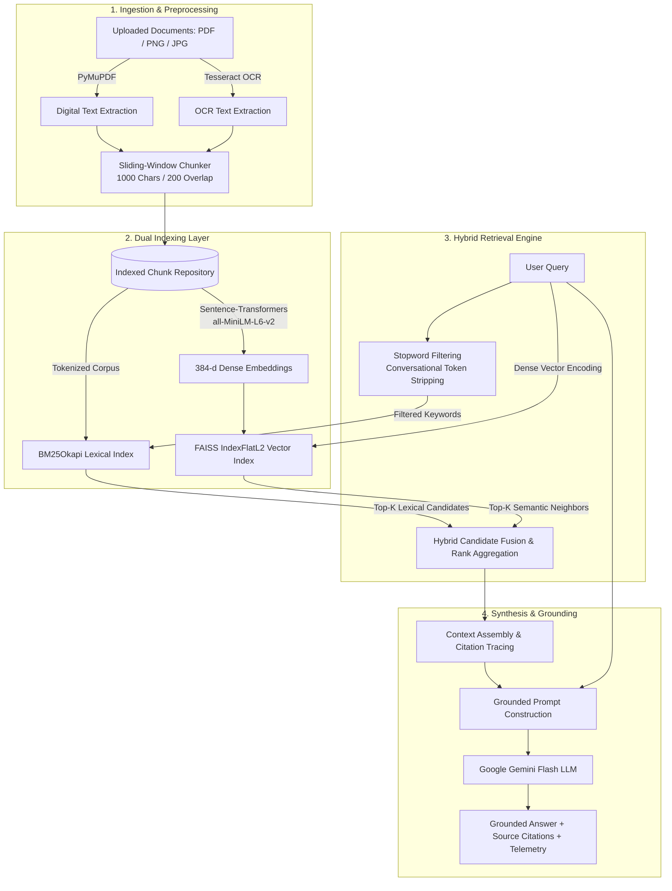

# 🧠 Context Management Engine (CME)

[](https://www.python.org/)
[](https://fastapi.tiangolo.com/)
[](https://react.dev/)
[](https://vitejs.dev/)
[](https://tailwindcss.com/)
[](https://github.com/facebookresearch/faiss)
[](https://ai.google.dev/)
[](LICENSE)

An intelligent, enterprise-grade **Context Management & Hybrid Retrieval-Augmented Generation (RAG) Engine**. CME pairs **dual lexical (BM25Okapi)** and **dense semantic (FAISS L2)** retrieval with multi-modal document extraction and strictly grounded **Google Gemini** generative synthesis.

---

## 📑 Table of Contents

- [Overview](#-overview)
- [Architecture & Workflow](#-architecture--workflow)
- [Key Features](#-key-features)
- [Model & Algorithmic Stack](#-model--algorithmic-stack)
- [Repository Structure](#-repository-structure)
- [Prerequisites & Installation](#-prerequisites--installation)
- [Configuration (.env)](#-configuration-env)
- [Running the Application](#-running-the-application)
  - [Method 1: One-Click Startup (Recommended)](#method-1-one-click-startup-recommended)
  - [Method 2: FastAPI Bridge + React Frontend](#method-2-fastapi-bridge--react-frontend)
  - [Method 3: Standalone Streamlit Prototype](#method-3-standalone-streamlit-prototype)
- [API Specification](#-api-specification)
- [Evaluation & Retrieval Telemetry](#-evaluation--retrieval-telemetry)
- [Troubleshooting & FAQ](#-troubleshooting--faq)

---

## 🔍 Overview

Standard RAG architectures often suffer from critical failure modes:
1. **Lexical Blindness**: Pure vector/semantic search frequently misses exact keyword queries, alphanumeric serial numbers, mathematical variables, and domain acronyms.
2. **Semantic Drift & Context Bloat**: Overly broad text windows cause the LLM to encounter irrelevant information ("lost-in-the-middle" problem).
3. **Hallucination**: LLMs extrapolate unsupported claims when provided incomplete or ambiguous context.

The **Context Management Engine (CME)** resolves these challenges by introducing:
- **Intelligent Multi-Modal Extraction**: Digital text parsing for PDFs combined with OCR for image-based documents.
- **Sliding-Window Context Segmentation**: Chunks text with controlled overlap to preserve contiguous semantic meaning across boundaries.
- **Dual Lexical + Dense Semantic Hybrid Retrieval**: Fuses filtered BM25Okapi scoring with FAISS vector similarity search.
- **Conversational Query Sanitization**: Strips conversational filler (e.g., *"explain to me in layman's terms"*) from lexical matching while retaining full context for dense embeddings.
- **Strict Grounding Guardrails**: Prompt constraints enforce that answers derive solely from ingested documents; absent topics elicit a strict `"The information is not provided."` response.

---

## 🏗 Architecture & Workflow



---

## ✨ Key Features

- **Dual-Retriever Pipeline (BM25 + FAISS)**:
  - Lexical keyword matching with custom domain stopword filtering.
  - Dense semantic retrieval powered by `sentence-transformers/all-MiniLM-L6-v2` and `FAISS IndexFlatL2`.
- **Optical & Native Ingestion**:
  - Direct PDF text extraction via **PyMuPDF (`fitz`)**.
  - Image OCR (`.png`, `.jpg`, `.jpeg`) via **Tesseract OCR** and **PIL**.
- **Sliding-Window Chunking**:
  - Configurable 1000-character windows with a 200-character overlap, maintaining contextual continuity across chunk boundaries.
- **Strict Anti-Hallucination Guardrails**:
  - System prompts instruct the LLM to operate solely on retrieved excerpts. If context is missing, it explicitly reports `"The information is not provided."`.
- **Full Retrieval Telemetry & Inspection**:
  - Live API inspection of tokenized queries, removed conversational stopwords, BM25 scores, FAISS Euclidean distances, and hybrid ranks.
- **Modern Full-Stack Experience**:
  - **React 19 + TypeScript + Vite + Tailwind CSS v4** UI with dark mode, animations, document management, and interactive query history.
  - **FastAPI Bridge** providing standard RESTful communication.
  - **Streamlit Prototype** for rapid local ML testing.

---

## 🔬 Model & Algorithmic Stack

| Component | Technology / Model | Specification |
| :--- | :--- | :--- |
| **Embedding Model** | `sentence-transformers/all-MiniLM-L6-v2` | 384 dimensions, 120M parameters, optimized for semantic search |
| **Vector Index** | `faiss.IndexFlatL2` | Exact Euclidean distance $L_2$ nearest-neighbor search |
| **Lexical Engine** | `rank-bm25` (`BM25Okapi`) | Probabilistic relevance scoring with conversational stopword exclusion |
| **Generative LLM** | Google Gemini (`gemini-1.5-flash` / `gemini-2.0-flash` / `gemini-3.5-flash`) | Fast, grounded inference with temperature & safety controls |
| **PDF Extraction** | PyMuPDF (`fitz`) | High-throughput digital stream parsing |
| **OCR Engine** | Tesseract OCR + `pytesseract` | Optical character extraction for scanned imagery |
| **Backend Framework**| FastAPI + Uvicorn | Asynchronous Python REST API layer |
| **Frontend Framework**| React 19 + TypeScript + Vite | Tailwind CSS v4, Lucide icons, Motion primitives |

---

## 📂 Repository Structure

```
Context_Management_Engine-main/
│
├── .env                                # Backend environment configuration (GEMINI_API_KEY)
├── API_CONTRACT.md                     # Frontend-Backend REST API contract
├── backend_bridge.py                   # FastAPI application bridging React to ML engine
├── package.json                        # Root npm script runner
├── README.md                           # Master project documentation
├── start.bat                           # Windows one-click dual launcher (Backend + Frontend)
│
├── frontend/                           # Modern React 19 web application
│   ├── index.html
│   ├── package.json
│   ├── vite.config.ts
│   └── src/
│       ├── api/                        # API client, types, and live/mock adapters
│       ├── components/                 # Reusable UI primitives (Buttons, Tabs, Overlay)
│       ├── features/                   # Feature modules (upload, documents, research)
│       ├── pages/                      # Dashboard, Research, DocumentDetail, Auth
│       └── state/                      # State hooks (auth, documents, history)
│
└── Context_Management_Engine-main/     # Core Python Engine & Prototype
    ├── app.py                          # Streamlit application with hybrid retrieval
    ├── requirements.txt                # Python dependencies for the ML engine
    └── try/
        └── try.py                      # Standalone HybridRAGEngine module
```

---

## 🚀 Prerequisites & Installation

### 1. System Requirements
- **Python**: Version 3.10 to 3.13 installed and added to `PATH`.
- **Node.js**: Version 18.x or 20.x+ (with `npm`).
- **Tesseract OCR (Optional, required only for image OCR)**:
  - Windows: Install from [UB-Mannheim Tesseract](https://github.com/UB-Mannheim/tesseract/wiki) and add to `PATH` (or configure in `try.py`: `C:\Program Files\Tesseract-OCR\tesseract.exe`).

### 2. Python Environment Setup
From the repository directory:
```bash
# Navigate to the Python root
cd Context_Management_Engine-main

# Install Core ML requirements
pip install -r Context_Management_Engine-main/requirements.txt

# Install FastAPI Bridge dependencies
pip install fastapi uvicorn python-multipart python-dotenv
```

### 3. Frontend Setup
```bash
cd frontend
npm install
```

---

## 🔑 Configuration (.env)

Create or update the `.env` file in the main folder:

```ini
# Google Gemini API Key
# Obtain a free key at: https://aistudio.google.com/app/apikey
GEMINI_API_KEY=your_api_key_here
```

> [!NOTE]
> The backend bridge automatically reads `GEMINI_API_KEY` from `.env`. If using the standalone Streamlit script, you can also set this variable in your environment or within `.env`.

---

## 🖥 Running the Application

### Method 1: One-Click Startup (Recommended for Windows)

Double-click `start.bat` or run:
```bat
.\start.bat
```
This automatically launches:
1. **Backend Bridge** on `http://localhost:8000`
2. **React Frontend** on `http://localhost:5173`

---

### Method 2: FastAPI Bridge + React Frontend

#### 1. Start the Backend Bridge:
```bash
python backend_bridge.py
# Server runs on: http://localhost:8000
# OpenAPI Docs:   http://localhost:8000/docs
```

#### 2. Start the React Frontend:
```bash
cd frontend
npm run dev
# Frontend runs on: http://localhost:5173
```

---

### Method 3: Standalone Streamlit Prototype

If you want to run the lightweight Streamlit GUI without the React frontend:
```bash
cd Context_Management_Engine-main
streamlit run try/try.py
# Or:
streamlit run app.py
```
Access the Streamlit interface at `http://localhost:8501`.

---

## 📡 API Specification

The FastAPI bridge provides RESTful endpoints matching [`API_CONTRACT.md`](API_CONTRACT.md):

### Key Endpoints

| Method | Endpoint | Description |
| :--- | :--- | :--- |
| `GET` | `/api/health` | Health status and engine readiness check |
| `GET` | `/api/documents` | Retrieve metadata of all ingested documents |
| `POST` | `/api/documents/upload` | Multipart upload (PDFs/images), chunking, and indexing |
| `DELETE` | `/api/documents/{id}` | Remove document and rebuild BM25 + FAISS indexes |
| `POST` | `/api/research/query` | Submit query for hybrid retrieval and grounded Gemini response |
| `POST` | `/api/retrieval/inspect` | Inspect query decomposition, BM25 scores, and FAISS distances |
| `GET` | `/api/evaluation/metrics` | Retrieve system evaluation benchmarks |
| `POST` | `/api/auth/login` | Session authentication |

#### Example Query Request
```http
POST /api/research/query
Content-Type: application/json

{
  "query": "What is the formula for Scaled Dot-Product Attention?",
  "topK": 5
}
```

#### Example Query Response
```json
{
  "answer": "Attention(Q, K, V) = softmax(Q * K^T / sqrt(d_k)) * V [Source 1].",
  "relevantChunks": [
    {
      "id": 1,
      "source": "attention.pdf",
      "text": "The attention function is computed as..."
    }
  ],
  "citations": [
    {
      "citationId": 1,
      "chunkId": 1,
      "source": "attention.pdf",
      "textExcerpt": "The attention function is computed as Attention(Q, K, V)...",
      "page": 1
    }
  ],
  "latencyMs": 412,
  "grounded": true
}
```

---

## 📊 Evaluation & Retrieval Telemetry

The engine tracks quantitative metrics across retrieval accuracy, latency, and context density:

- **Mean Precision@K**: Measures the proportion of relevant chunks retrieved in top-$K$.
- **Mean Recall@K**: Evaluates coverage of all relevant information present in the corpus.
- **Mean Reciprocal Rank (MRR)**: Measures how early the first relevant source appears in the ranked candidate list.
- **Mean NDCG@K**: Normalized Discounted Cumulative Gain accounting for graded ranking relevance.
- **Context Reduction Ratio**: Percentage of raw document context pruned while preserving 100% of answer-critical facts.

---

## 🛠 Troubleshooting & FAQ

#### 1. Gemini API Key Error (`API Error: 404 / 400`)
- **Fix**: Verify your `GEMINI_API_KEY` in `.env`. Obtain a valid key from [Google AI Studio](https://aistudio.google.com/app/apikey). Ensure the key begins with `AIza...`.

#### 2. Tesseract OCR Not Found
- **Fix**: If uploading images, ensure Tesseract is installed and in your system PATH, or uncomment line 12 in `try/try.py` and set the explicit path:
  ```python
  pytesseract.pytesseract.tesseract_cmd = r'C:\Program Files\Tesseract-OCR\tesseract.exe'
  ```

#### 3. Frontend Shows "Demo Data" Mode
- **Fix**: The frontend automatically connects to the live backend once `http://localhost:8000/api/health` responds. Ensure `backend_bridge.py` is actively running.

#### 4. FAISS CPU Installation on Windows
- **Fix**: Install `faiss-cpu` via `pip install faiss-cpu`. If using Python 3.13 and wheels are unavailable, use Python 3.11 or 3.12.

---

## 📄 License

This project is licensed under the MIT License. Feel free to adapt and expand it for research or commercial applications.

